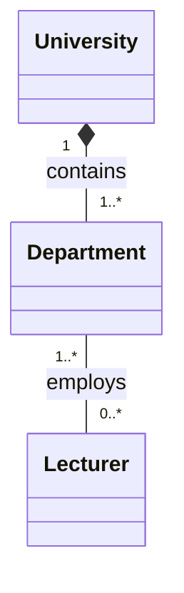
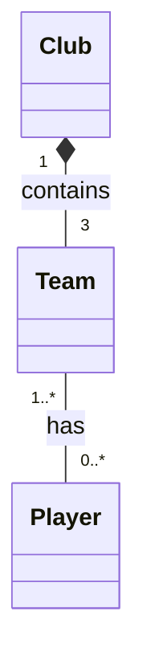

## Exercuse 2 - University Departments

### Explanation

- **University – Department:** Composition (`*--`). departments belong to the university and if the univertisy closes, the department disappears.
- **Department – Lecturer:** Association (`--`). Lecturers can teach in multiple departments so if the department closes, lecturers survives.
 

## Exercise 3 — Sports Club

### Class Diagram

### Explanation

**Club – Team: Composition (`*--`)**

- A club owns its teams.
- Each team belongs to exactly one club.
- no club, no team
- Multiplicity: One Club has three Teams (First Team, Reserve Team, and Youth Team).

**Team – Player: Association (`--`)**

- Players are assigned to teams.
- Players can move between teams and clubs.
- If a team is disbanded, players still exist.
- Multiplicity: A Team can have zero or more Players, and a Player can belong to one or more Teams over time (but normally one team at a time).

