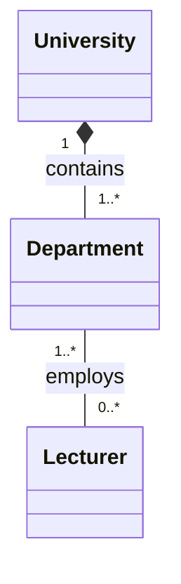
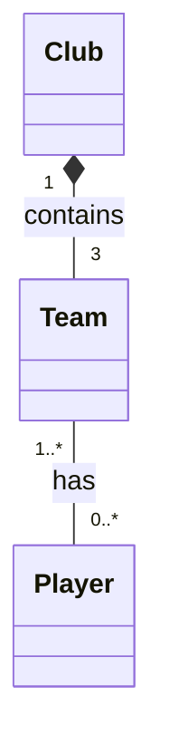
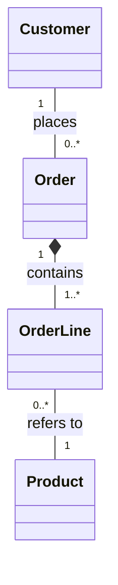

## Exercuse 2 - University Departments

### Explanation

- **University – Department:** Composition (`*--`). departments belong to the university and if the univertisy closes, the department disappears.
- **Department – Lecturer:** Association (`--`). Lecturers can teach in multiple departments so if the department closes, lecturers survives.
 

## Exercise 3 — Sports Club

### Class Diagram

### Explanation

**Club – Team: Composition (`*--`)**

- A club owns its teams.
- Each team belongs to exactly one club.
- no club, no team
- Multiplicity: One Club has three Teams (First Team, Reserve Team, and Youth Team).

**Team – Player: Association (`--`)**

- Players are assigned to teams.
- Players can move between teams and clubs.
- If a team is disbanded, players still exist.
- Multiplicity: A Team can have zero or more Players, and a Player can belong to one or more Teams over time (but normally one team at a time).

## Exercise 4 — Customer Orders

### Class Diagram

### Explanation

**1. Order – OrderLine: Composition (`*--`)**

- An order consists of one or more order lines.
- Each order line belongs to exactly one order.
- If an order is deleted, its order lines are deleted too.
- Multiplicity: One Order has one or more OrderLines.

**2. OrderLine – Product: Association (`--`)**

- An order line refers to a product in the catalog.
- Products exist independently of orders.
- Deleting an order line does not delete the product.
- Multiplicity: Each OrderLine refers to exactly one Product. A Product can appear in zero or more OrderLines.

**3. Customer – Order: Association (`--`)**

- A customer can place multiple orders.
- Each order belongs to exactly one customer.
- Deleting an order does not mean the customer is deleted.
- Multiplicity: One Customer can have zero or more Orders. Each Order belongs to one Customer.